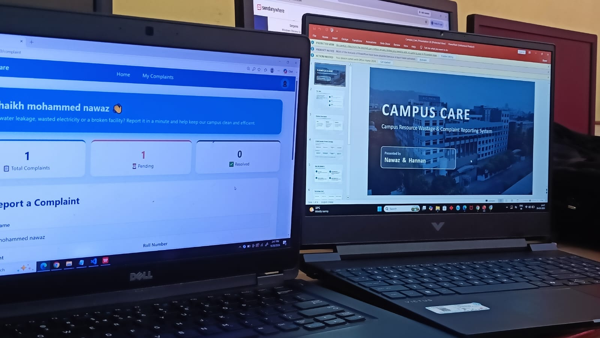

# 🏫 Campus Care

Campus Resource Wastage & Complaint Reporting System.

Students can report campus problems (water leakage, electricity wastage, broken equipment) with photo evidence, and the admin can track and resolve them.

## ⏱️ Built in 45 Minutes
This project was built in just **45 minutes** during a project competition held on **29 September 2026**.

## Features
- Student register / login
- Submit complaints with live camera or gallery photo as evidence
- My Complaints page with status tracking
- Admin dashboard to view evidence and mark complaints resolved

## How to run
1. Install Flask: `pip install flask`
2. Run: `python app.py`
3. Open: http://localhost:5000

## Made by
Nawaz & Hannan